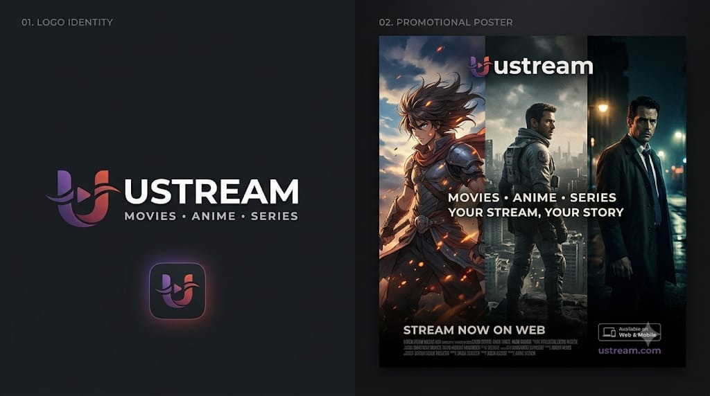

# UstreamPro 🎬

A modern, responsive live streaming web application with multi-resolution streaming, episodic show queues, curated catalogs, and secure serverless API proxies.



## ✨ Features

- **Movies, Series & Anime Collections**: Live catalog browsing with real-time category filtering (Action, Drama, Sci-Fi, Comedy, Anime).
- **Secure Netlify Serverless Proxy**: All backend RapidAPI calls are routed through serverless functions (`/.netlify/functions/api`), ensuring API keys are never exposed to client-side network inspectors.
- **Smart Video Player & State Machine**:
  - Non-overlapping, robust playback states (`IDLE`, `LOADING`, `READY`, `PLAYING`, `ERROR`).
  - Multi-resolution stream selector (`1080p`, `720p`, `480p`, `Auto`).
  - Episodic season & episode controls with automatic "Up Next" queue progression.
  - Subtitle and audio track preference selection.
- **Unified Navigation & Routing**:
  - Desktop top navigation bar + responsive mobile bottom tab bar.
  - Vanilla JS client-side hash routing (`#home`, `#movies`, `#series`, `#anime`, `#my-list`, `#profile`).
  - Interactive Profile management view with playback quality preferences and stats.
- **Lucide SVG Icon System**: Clean, accessible, consistent vector icons (`currentColor`) with micro-interactions and touch states.
- **Showcase Catalog Fallback**: Instant offline / showcase mode populated with curated titles so the UI remains rich even if external API limits are exceeded.

---

## 🚀 Live Hosting & Mobile Testing

### 1. Production Deployment (Netlify)
The site is pre-configured with `netlify.toml` for zero-config Netlify continuous deployment.

1. Connect this repository ([dheeraj136/UstreamPro](https://github.com/dheeraj136/UstreamPro)) on [Netlify](https://app.netlify.com).
2. Configure build settings (already defined in `netlify.toml`):
   - **Build command**: `npm run build`
   - **Publish directory**: `public`
   - **Functions directory**: `netlify/functions`
3. Add Environment Variables in Netlify (**Site settings &rarr; Environment variables**):
   - `RAPID_API_KEY`: Your RapidAPI MovieBox API key
   - `RAPID_API_BASE`: `https://moviebox-api.p.rapidapi.com` (optional, defaults to this)
   - `RAPID_API_HOST`: `moviebox-api.p.rapidapi.com` (optional, defaults to this)
4. Deploy site. Your live production URL (e.g., `https://ustreamonline.netlify.app/` or your custom Netlify subdomain) will be accessible on all mobile devices, smart TVs, tablets, and desktop browsers.

### 2. Testing On Other Devices via Local Network / Tunnel

To test your local instance immediately on your mobile phone or other devices on the same Wi-Fi:

1. **Local Wi-Fi Network**:
   - Find your computer's local IP (e.g., `ipconfig` &rarr; IPv4 Address: `192.168.x.x`).
   - Start the server: `npm start`
   - Open `http://<YOUR_LOCAL_IP>:4174` on your phone's browser connected to the same Wi-Fi.

2. **Instant Cloud Tunnel (localtunnel / ngrok / Cloudflare)**:
   - Run:
     ```bash
     npx localtunnel --port 4174
     ```
   - This gives a public HTTPS URL (e.g., `https://ustream-demo.loca.lt`) accessible from anywhere on any mobile device.

---

## 💻 Local Development

### Prerequisites
- Node.js >= 20.0.0

### Setup
1. Clone the repository:
   ```bash
   git clone https://github.com/dheeraj136/UstreamPro.git
   cd UstreamPro
   ```

2. Copy `.env.example` to `.env`:
   ```bash
   cp .env.example .env
   ```

3. Add your RapidAPI key in `.env`:
   ```env
   RAPID_API_KEY=your_rapidapi_key_here
   ```

4. Install dependencies (if any) and start the local development server:
   ```bash
   npm start
   ```

5. Open [http://localhost:4174](http://localhost:4174) in your browser.

---

## 📁 Project Structure

```text
UstreamPro/
├── assets/
│   └── icons.js              # Standardized Lucide SVG icon system
├── netlify/
│   └── functions/
│       └── api.mjs           # Netlify serverless API proxy & rate-limiter
├── scripts/
│   └── build.mjs             # High-speed asset sync & build script
├── .env.example              # Documented environment variables template
├── app.js                    # Core frontend client application & routing
├── index.html                # Semantic HTML5 shell & accessible dialogs
├── netlify.toml              # Netlify build, redirects, and edge configuration
├── package.json              # Project scripts and node engine specs
├── server.mjs                # Local proxy & development HTTP server
└── styles.css                # Adaptive layout, animations & Lucide icon styles
```

---

## 📜 License
MIT © [dheeraj136](https://github.com/dheeraj136)
